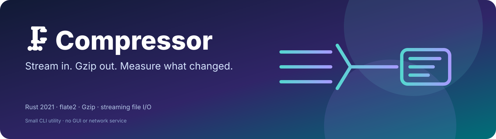
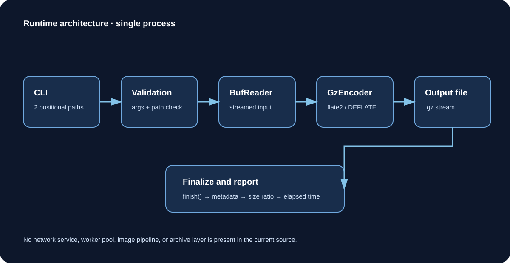
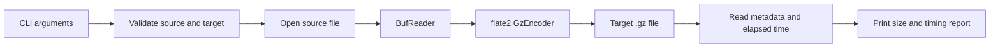
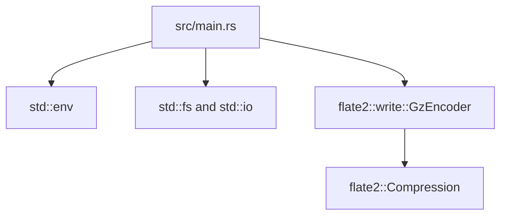
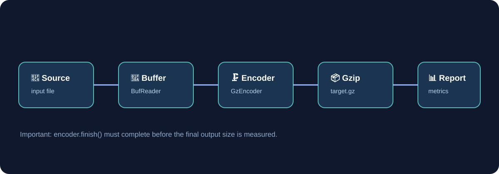
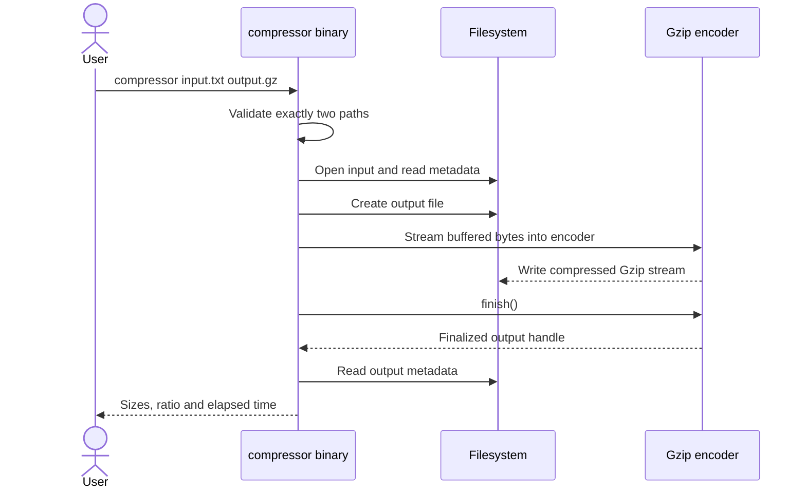

# 🗜️ Compressor

<div align="center">



[](https://www.rust-lang.org/)
[](https://doc.rust-lang.org/cargo/)
[](https://github.com/Brajesh31/compressor/actions/workflows/ci.yml)
[](https://github.com/Brajesh31/compressor/actions/workflows/codeql.yml)
[](LICENSE)
[](https://github.com/Brajesh31/compressor/commits/main)
[](https://github.com/Brajesh31/compressor/issues)
[](https://github.com/Brajesh31/compressor/stargazers)

**Compress files. Measure results. Keep the workflow simple.**

</div>

> A small Rust command-line program that streams an input file through the `flate2` Gzip encoder and writes a `.gz` output file.

## 🧭 Table of Contents

- [🎯 Project overview](#-project-overview)
- [✨ Features](#-features)
- [🏛️ Architecture](#-architecture)
- [🔀 Compression flow](#-compression-flow)
- [🛠️ Requirements](#-requirements)
- [🚀 Installation and usage](#-installation-and-usage)
- [📊 Output and metrics](#-output-and-metrics)
- [🧪 Tests and quality](#-tests-and-quality)
- [🔐 Safety and limitations](#-safety-and-limitations)
- [🗺️ Roadmap](#-roadmap)
- [📚 Documentation](#-documentation)
- [🤝 Contributing](#-contributing)
- [📄 License](#-license)

## 🎯 Project overview

This repository currently implements a **single-file Gzip compressor**. It is intentionally small: one binary, one external crate dependency, and a streaming copy into a Gzip encoder.

It is not currently an image optimizer, ZIP archiver, directory packer, GUI application, or network compression service. Those ideas are listed as possible future directions, not shipped capabilities.

## ✨ Features

- 🦀 Written in Rust 2021.
- 📦 Gzip output using `flate2` and the default compression level.
- 🌊 Buffered input and streaming encoding, avoiding a full-file in-memory buffer.
- 📏 Reports source and compressed output sizes.
- ⏱️ Reports elapsed compression time.
- ♻️ Uses standard Gzip format, compatible with common decompression tools.
- 🧪 Tests successful round-trip decompression, empty inputs, same-path rejection, missing sources, and byte formatting.

## 🏛️ Architecture



The current runtime has a simple pipeline:



### 🧱 Component view



## 🔀 Compression flow





## 🛠️ Requirements

- Rust stable toolchain.
- Cargo (included with rustup).
- Operating system supported by Rust and the `flate2` dependency.

Check the installed versions:

```bash
rustc --version
cargo --version
```

## 🚀 Installation and usage

Clone and build:

```bash
git clone https://github.com/Brajesh31/compressor.git
cd compressor
cargo build --release
```

Run:

```bash
cargo run --release -- input.txt output.txt.gz
```

After building, the binary is available at `target/release/compressor`:

```bash
./target/release/compressor input.txt output.txt.gz
```

Decompress with a standard Gzip tool:

```bash
gzip -dk output.txt.gz
```

The command creates or overwrites the target path. Do not use the same path for source and target. Parent directories must already exist.

## 📊 Output and metrics

The program reports:

| Metric | Meaning |
|---|---|
| Source size | Original input file length in bytes, displayed using readable units |
| Target size | Final Gzip file size after encoder finalization |
| Output/input | Compressed size as a percentage of the source size |
| Space saved | One hundred percent minus the output/input percentage |
| Elapsed | Wall-clock time spent copying and finalizing the encoder |

Compression may increase file size for small, already-compressed, or high-entropy inputs. Empty input has no meaningful output/input ratio and is reported as `n/a`.

## 🧪 Tests and quality

Run the unit tests:

```bash
cargo test
```

Run formatting and lint checks:

```bash
cargo fmt --all -- --check
cargo clippy --all-targets --all-features -- -D warnings
```

Build the release binary:

```bash
cargo build --release
```

The tests use temporary files and verify that the Gzip output can be decompressed back to the original bytes.

## 🔐 Safety and limitations

- The output path is created or truncated. Existing output data may be overwritten.
- The source and target must not refer to the same path. Different path spellings or symlinks that resolve to the same underlying file are not fully canonicalized.
- A failed write can leave a partial output file.
- No atomic temporary-file rename is implemented.
- No checksum report or integrity manifest is persisted separately. Gzip itself includes format-level integrity data.
- No directory recursion, ZIP/TAR containers, encryption, password protection, multithreaded compression, or decompression command is implemented.
- Timing values are local measurements and are not benchmark claims.

## 🗺️ Roadmap

Potential directions, not implemented features:

1. 🧰 Add structured CLI options for compression level and output naming.
2. 🧪 Add integration tests for filesystem edge cases and overwrite behavior.
3. 🛡️ Write to a temporary file and atomically rename on success.
4. 📂 Add optional directory traversal and archive packaging as a separate feature.
5. 📈 Add reproducible benchmarks across file types and compression levels.
6. 🔄 Add a decompression subcommand with validation.
7. 🧵 Evaluate parallel compression only after profiling shows a benefit.

## 📚 Documentation

- [Documentation index](docs/README.md)
- [Architecture and design](docs/architecture/README.md)
- [CLI reference](docs/reference/cli.md)
- [Compression format notes](docs/reference/gzip-format.md)
- [Security model](docs/security/threat-model.md)
- [Testing strategy](docs/quality/testing.md)
- [Benchmark methodology](docs/quality/benchmarks.md)
- [Operations and troubleshooting](docs/operations/troubleshooting.md)
- [Diagram library](docs/diagrams/README.md)
- [Architecture Decision Records](docs/architecture/decisions/README.md)
- [Reusable templates](docs/templates/README.md)

## 🤝 Contributing

Read [CONTRIBUTING.md](CONTRIBUTING.md), follow the Rust formatting and lint rules, and include tests for behavior changes. Bug reports should include safe reproduction steps and the Rust toolchain version.

## 📄 License

This project is licensed under the MIT License. See [LICENSE](LICENSE).

Last updated: 2026-11-17 23:28 UTC
